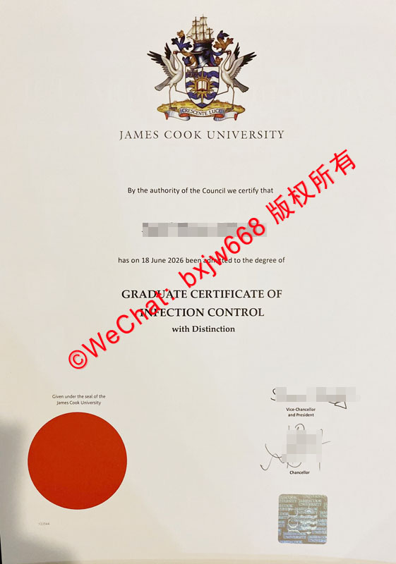

# 澳大利亚詹姆斯库克大学毕业证样式范本（jcu Diploma)核算特征

在海外留学和学历认证领域，**澳大利亚詹姆斯库克大学（James Cook University，简称 JCU）**作为澳洲顶尖的公立研究型大学，其颁发的学位证书（Diploma / Degree Certificate）具有极高的国际认可度。对于毕业生、人力资源部门（HR）以及第三方背调机构而言，深入了解 **JCU 毕业证的官方样式范本与其核心核算特征（Verification Features）**，是确保学历真实性、规避虚假证书风险的关键。

本文将基于 JCU 官方发布的最新证书排版规范，深度剖析其防伪与设计特征，帮助您快速识别正品。

## 1. 詹姆斯库克大学毕业证外观设计（JCU Diploma Design & Layout）

### 盾徽与校名（The University Coat of Arms）
詹姆斯库克大学毕业证的顶部正中，印有学校极其精细的**官方盾徽（Coat of Arms）**。
* **视觉元素**：盾徽上方包含一艘航海帆船，两侧由澳洲标志性的珍稀鸟类（如鹤类）作为护盾兽，底部带有拉丁文校训。整个校徽色彩饱和度高、线条清晰。
* **印刷工艺**：正品证书的校徽并非普通平面油墨印刷，而是采用高精度的防伪印刷技术，文字与线条在放大观察时边缘极为锐利，无模糊或重影现象。

### 核心文本排版
校徽下方为统一的标志性宣告文本：
> *"By the authority of the Council we certify that..."*

证书正文采用优雅的衬线字体（Serif Font），字距与行距经过严格的排版美学核算。学生的姓名、授予日期（例如 *18 June 2026*）以及所获学衔（如 *GRADUATE CERTIFICATE OF INFECTION CONTROL*）会以加粗、放大的形式居中呈现，整体布局严谨且留白匀称。

## 2. 核心核算特征与防伪标识（JCU Certificate Verification Features）

要核算一份 JCU 毕业证的真伪，必须重点审查证书下半部分的几个核心物理防伪特征。

### 红色晶片火漆印（The Red Wafer Seal）
在证书的左下角，有一个非常瞩目的**大红色圆形印章（Red Wafer Seal）**。
* **物理特征**：该印章采用特殊的有色贴纸或热敏压印技术，表面平整。
* **核算要点**：其上方通常印有象征学校法定效力的文字 *"Given under the seal of the James Cook University"*。在进行高分辨率扫描或肉眼贴近观察时，该红色圆圈的边缘无任何锯齿，颜色纯正。

### 官方授权签名（Authorized Signatures）
证书右下角包含两位学校最高行政长官的亲笔签名（或高精度数字化防伪签名复刻）：
* **校长（Vice-Chancellor and President）**
* **校董/大法官（Chancellor）**
* **核算要点**：签名的字迹流畅，线条粗细随笔触自然变化，且签名下方紧跟其对应的官方职称。

### 高防伪全息标签（Holographic Security Sticker）
在签名下方，贴有一枚**正方形的激光全息防伪标签（Holographic Sticker）**。
* **光学效应**：该标签在不同光线角度下会呈现出五彩斑斓的衍射光芒，并隐约显现出“JCU”或学校盾徽的微缩图案。
* **核算要点**：这是现代 JCU 毕业证最难被复制的防伪核算特征之一。普通复印件或低端仿制品在该区域往往会失去流光效果，呈现一片死灰或模糊的色块。

## 3. 澳大利亚学历资格框架（AQF）下的 JCU 证书核算等级

詹姆斯库克大学作为澳大利亚高等教育体系的一部分，其颁发的所有文凭均严格遵循**澳大利亚学历资格框架（Australian Qualifications Framework, AQF）**的核算标准。

无论是学士学位（Bachelor）、硕士学位（Master），还是研究生证书（Graduate Certificate），证书上所标注的荣誉级别（如 *with Distinction*）都必须与学校内部教务系统（Student Management System）中的学分核算、GPA 评级完全吻合。

## 4. 如何官方核算 JCU 毕业证的真实性？（How to Verify JCU Qualifications）

虽然物理特征可以作为初步筛查的依据，但最终的“核算”仍需依赖官方渠道。以下是主流的两种官方验证方式：

### 1. JCU 官方在线验证系统（JCU Online Verification Portal）
詹姆斯库克大学为公众、雇主和背调机构开放了合法的学历验证端口。
* **操作流程**：登录 JCU 官网的 Qualification Verification 页面，输入毕业证上载明的**学生姓名（Student Name）、学生ID（Student ID）以及毕业日期**。
* **核算结果**：系统会自动比对数据库，若证书属实，则会在线显示该毕业生的学位授予状态。

### 2. 通过 My eQuals 平台进行数字化核算
自 2017 年起，澳大利亚和新西兰的大多数高校（包括 JCU）均全面启用了 **My eQuals** 数字化证书平台。
* **特点**：毕业生可以通过该平台生成带有加密数字签名（Digital Signature）的官方电子版毕业证与成绩单。
* **优势**：接收方只需点击链接，即可直接在 My eQuals 官方服务器上核算该文凭的真实性，完全杜绝了纸质证书被伪造、篡改的风险。

## 结语

综上所述，**澳大利亚詹姆斯库克大学毕业证样式范本**不仅融合了传统的西方学院派美学，更在**红色火漆印、高精度签名、激光全息防伪标签**等物理特征上设立了极高的技术壁垒。在日常的学历核查或留学生落户、人才引进申报中，结合物理特征观察与 **My eQuals 官方数字化渠道**进行双重核算，才是确保文凭真实性的最稳妥方案。比对和成果展示时提供清晰、可靠的视觉与逻辑依据。

